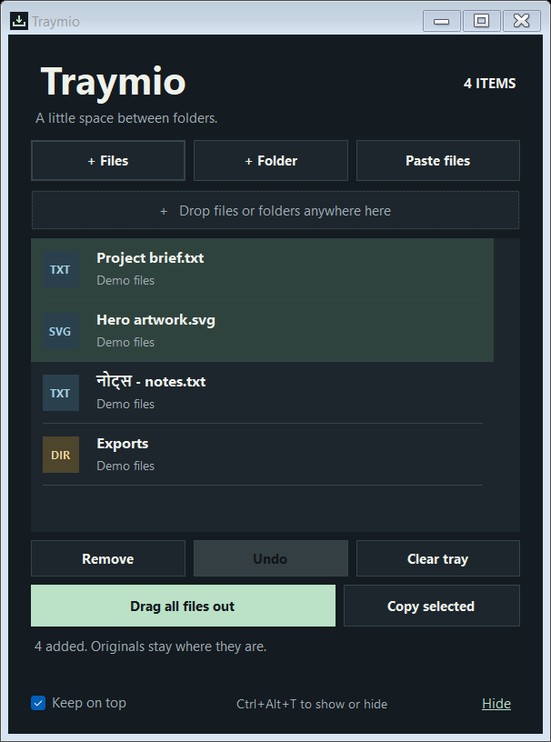

<div align="center">

# Traymio

**A little space between folders.**

A lightweight floating file tray for Windows. Collect files from different places, then drag or copy them together.

[](https://github.com/kartikvermagit-ds/Traymio/releases/latest/download/Traymio.exe)
[](https://github.com/kartikvermagit-ds/Traymio/releases/latest)
[](https://github.com/kartikvermagit-ds/Traymio/actions/workflows/build.yml)
[](LICENSE)

[Download ZIP](https://github.com/kartikvermagit-ds/Traymio/releases/latest/download/Traymio-Windows.zip) · [Hindi guide](docs/README.hi.md) · [Report a bug](https://github.com/kartikvermagit-ds/Traymio/issues/new?template=bug_report.yml)



*Actual app interface with synthetic sample items and demo paths.*

</div>

Gather a document from one folder, artwork from another, and an export folder from somewhere else. Traymio holds them in one small window while you navigate to their destination. Your originals stay where they are.

## Download and get started

1. **[Download Traymio.exe](https://github.com/kartikvermagit-ds/Traymio/releases/latest/download/Traymio.exe)** and open it. No installer or administrator access is needed.
2. Drop files or folders from File Explorer into the tray. Add more from other locations.
3. Hold **Drag all files out** and drag into your destination folder or a compatible app.
4. For a subset, select rows and drag those rows. Or click **Copy all / Copy selected**, then paste with **Ctrl+V** in File Explorer.

Prefer a package? [Download the Windows ZIP](https://github.com/kartikvermagit-ds/Traymio/releases/latest/download/Traymio-Windows.zip), extract it, and open `Traymio.exe`. GitHub's **Code → Download ZIP** contains source; release downloads contain the ready-to-run app.

Designed for Windows 10/11 with the built-in .NET Framework 4.x runtime. Python, Node.js, and the .NET SDK are not required to run it. This release is unsigned; Windows may show an unknown-publisher warning. SHA-256 checksums accompany the downloads.

## A small tray, useful controls

| Feature | What it does |
| --- | --- |
| Collect across folders | Add existing files and folders by drop, picker, or clipboard |
| Copy-only transfer | Offers copying to the destination; never moves originals itself |
| Multi-select | Drag or copy only the items you choose |
| Duplicate detection | Skips references already in the tray |
| Remove, clear, and undo | Changes the tray list, not files on disk |
| Keep on top | Keeps the tray above ordinary windows while you collect |
| Global shortcut | **Ctrl+Alt+T** shows or hides the running app |
| Notification-area icon | Reopen the tray or exit from its icon menu |
| Reveal in Explorer | Double-click an item to show its location without executing it |
| Missing-file handling | Marks unavailable items and blocks transfers containing them |

## Temporary tray, unchanged originals

Traymio stores **references to existing paths**, not backup copies. Moving or deleting a source outside the app makes its tray entry unavailable; add it again from its new location. Removing entries or clearing the tray does not delete source files.

**Hide keeps your tray running. Closing with X or Exit clears the session.** This version does not save shelves, run at Windows startup, or keep a history. Each window holds up to 300 items. Undo restores the most recent removal or clear operation, subject to that limit.

## Keyboard shortcuts

| Shortcut | Action |
| --- | --- |
| Ctrl+click / Shift+click | Select multiple rows |
| Ctrl+A | Select all tray items |
| Ctrl+C | Copy selected items, or all if none are selected |
| Ctrl+V | Add files copied from File Explorer |
| Delete | Remove selected tray references |
| Ctrl+Z | Undo the last removal or clear |
| Escape | Hide to the notification area |
| Ctrl+Alt+T | Show/hide Traymio while it is running |

If another app or Traymio window owns **Ctrl+Alt+T**, the app shows a message and the notification-area icon remains available. Windows may place it behind the hidden-icons arrow.

## Compatibility and privacy

- Existing filesystem files and folders are supported. Plain text, web links, clipboard screenshots, and virtual Outlook attachments are not. Save virtual content to disk first.
- The destination decides which drops it accepts. Web apps may not accept folders. Windows can block drag/drop between apps running at different privilege levels.
- The destination handles its own duplicate-name and overwrite prompts. Traymio does not suppress those prompts.
- Traymio does not recursively inspect folders or cache their contents. Large file copying is handled by the destination.
- The app makes no network requests and does not persist the tray paths. **Copy** explicitly places file references on the Windows clipboard; your normal clipboard settings still apply.
- To uninstall, exit Traymio and delete its folder.

## Build and validation

On Windows, run from a source checkout:

```powershell
.\scripts\build.ps1 -Test -Package
```

The script uses the Windows .NET Framework compiler, produces `dist/Traymio.exe`, runs generated-file tests, and packages the executable and checksums. See [CONTRIBUTING.md](CONTRIBUTING.md).

Automated checks cover collection, duplicate detection, unavailable paths, undo, the copy-only file-drop payload, source-file integrity, and UI handlers. **Live dragging into Explorer, clipboard integration, the notification icon, shortcut conflicts, network paths, and mixed-DPI setups still require manual verification.** The tests do not overwrite the real clipboard or register a global shortcut.

## Feedback

[Report a bug](https://github.com/kartikvermagit-ds/Traymio/issues/new?template=bug_report.yml) with your Windows version, scaling, and destination app, or [suggest a feature](https://github.com/kartikvermagit-ds/Traymio/issues/new?template=feature_request.yml). Redact private filenames and paths in screenshots. If Traymio helps your workflow, a star helps other people find it.

Released under the [MIT License](LICENSE).
